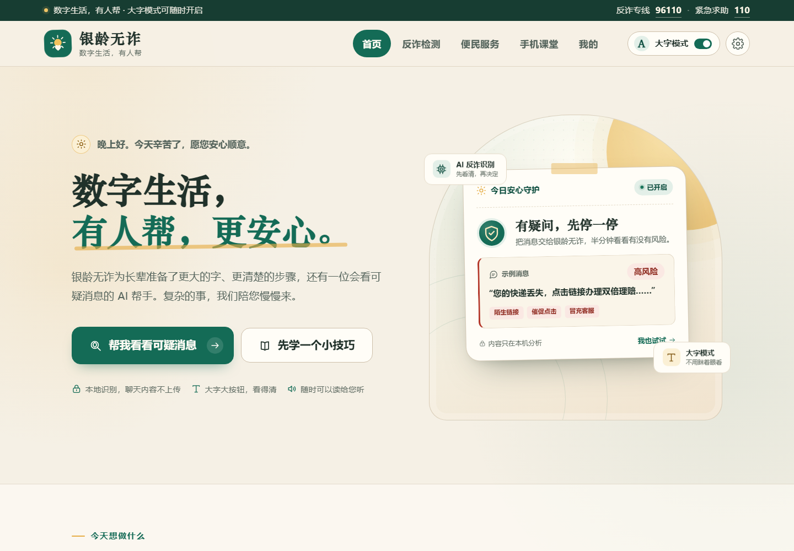

# 银龄无诈 · 老年人数字助老 Web 平台

面向长辈的数字生活助手。用更大的字、更清楚的步骤和本地的反诈识别，帮助长辈看得清、学得会、遇事不慌。

纯前端项目：**HTML + CSS + 原生 JavaScript**，无构建步骤、无第三方运行时依赖。



## 功能一览

| 页面 | 能做什么 |
| --- | --- |
| 首页 `index.html` | 时段问候、快捷办事入口、AI 反诈能力介绍、手机课堂推荐、安心使用说明 |
| 反诈识别 `fraud.html` | 粘贴短信 / 聊天记录 / 网址，本地分析 19 类常见骗术；风险评分、疑点解释、原文标记、下一步建议、朗读、分享、最近记录 |
| 便民服务 `services.html` | 挂号、医保、社保认证、缴费、话费、打车、视频通话、查快递；大字分步指南，可搜索、筛选、朗读、复制；紧急电话与亲情联系人 |
| 手机课堂 `learn.html` | 6 节大字课程、学习进度、一键朗读、反诈小测验与最好成绩 |
| 我的设置 `profile.html` | 字号 / 高对比度 / 减少动画 / 自动朗读、亲情电话、识别记录、学习档案、本机数据清除 |

## 适合长辈的设计

- **老年大字体模式**：默认「大字」，一键切换标准 / 大字 / 特大；整站字号联动，刷新后记住设置。
- **高对比度模式**：更清楚的边界和文字，不改变内容结构。
- **语音优先**：识别结果、办事步骤、课程内容都可以朗读；支持浏览器语音输入（Chrome / Edge）。
- **大按钮、少绕路**：主要按钮最小高度 52px，重点操作 60px；移动端单列布局。
- **可理解的反馈**：按钮状态、识别结果、测验反馈均有文字说明；支持键盘焦点和 `aria-live`。
- **尊重与安心**：不使用「老年人模式」等标签，不制造恐慌；提示「被骗不是您的错」。

## 本地反诈识别怎么工作

识别逻辑在 `js/fraud-engine.js` 中，完全在浏览器本地执行，不发送任何网络请求：

1. 匹配 19 类常见骗术特征，例如冒充公检法、安全账户、索要验证码、屏幕共享、陌生链接、冒充亲友、高收益投资等。
2. 分析消息中的网址：HTTP、IP 地址、短链接、不常见域名后缀、Punycode、多层子域名、URL 中的 `@` 等。
3. 综合特征数量与严重程度计算 0–100 的风险分，映射为高风险 / 中风险 / 需要留意 / 暂未见明显风险。
4. 输出可疑点解释、原文高亮标记、当前行动步骤和一句防骗口诀。

> 这是一个可离线运行的前端启发式「AI 反诈」实现，用于项目演示，**不是真正的机器学习模型，也不能替代警方判断**。若要接入大模型或官方风控接口，可在 `FraudEngine.analyze` 外增加一层异步 API 调用，并保留本规则引擎作为断网兜底。

可快速试用：

- `fraud.html?demo=package` 自动填入并分析「快递理赔」样例
- `fraud.html?demo=authority` 冒充公检法
- `fraud.html?demo=investment` 高收益投资
- `fraud.html?demo=safe` 正常社区通知

## 运行

需要 Node.js 18+（或任意静态文件服务器）。

```bash
node server.js
# 打开 http://127.0.0.1:4173
```

或使用：

```bash
npx serve .
# 或
python -m http.server 4173
```

> 建议通过 `http://localhost` 访问，而不是直接双击 `file://`。浏览器语音识别等功能在本地服务器下更稳定。

## 目录结构

```text
.
├─ index.html
├─ fraud.html
├─ services.html
├─ learn.html
├─ profile.html
├─ css/
│  ├─ base.css       # 设计系统、头部、按钮、弹窗、无障碍模式
│  ├─ pages.css      # 首页与内页公共头
│  ├─ fraud.css
│  ├─ services.css
│  ├─ learn.css
│  └─ profile.css
├─ js/
│  ├─ app.js         # 设置、图标、语音、弹窗、Toast、本地存储
│  ├─ home.js
│  ├─ fraud-engine.js
│  ├─ fraud.js
│  ├─ services.js
│  ├─ learn.js
│  └─ profile.js
├─ assets/favicon.svg
├─ server.js         # 零依赖本地预览服务器
└─ screenshots/
```

## 数据与隐私

所有数据只保存在当前浏览器的 `localStorage`，不会上传：

| Key | 内容 |
| --- | --- |
| `yinling.settings.v1` | 字号、对比度、减少动画、自动朗读、称呼、亲情联系人 |
| `yinling.fraudHistory.v1` | 最近 6 条反诈识别记录 |
| `yinling.learning.v1` | 已学会课程 |
| `yinling.quizBest.v1` | 小测验最好成绩 |

在「我的」页面可以清空识别记录，或一键清除全部本机数据。

## 已验证

- Chrome / Edge 最新版，桌面 1440px、平板 768px、手机 390px 下无横向溢出。
- 字号「特大」模式下 320–1440px 布局正常。
- 反诈样例覆盖：快递理赔、冒充公检法、高收益投资、冒充亲友、正常社区通知。
- 服务筛选 / 搜索、步骤弹窗、课程完成、小测验、亲情联系人、本机数据清除、显示设置持久化均已通过浏览器交互检查。
- 全站无外部资源请求，断网也能打开。

## 说明

本项目是前端演示项目，反诈识别结果和办事步骤仅作参考。遇到转账、汇款要求，请先联系家人或拨打 **96110**；紧急情况请拨打 **110**。
