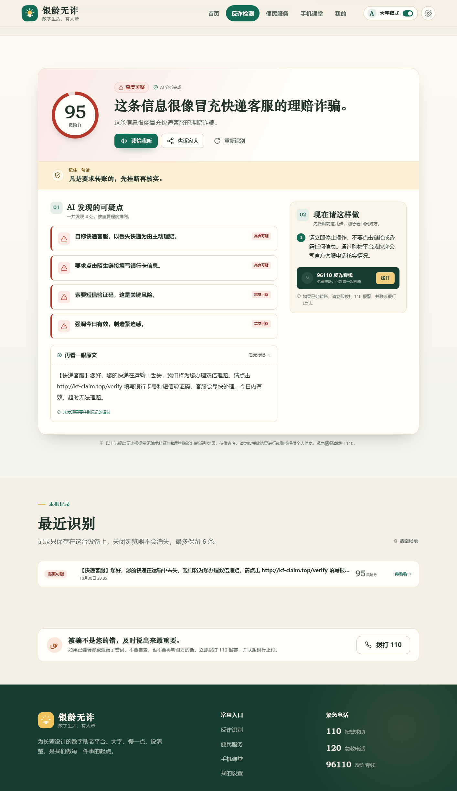
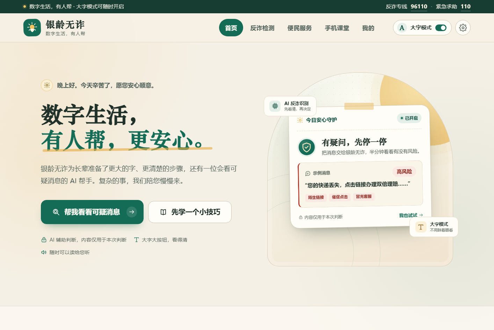
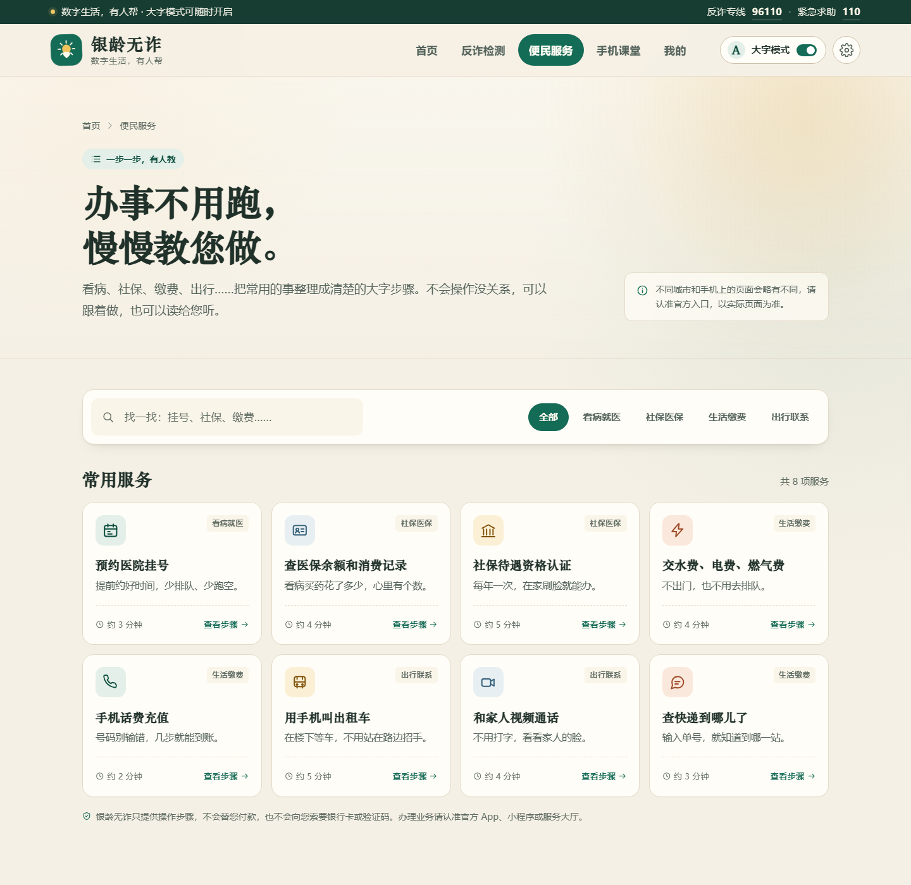
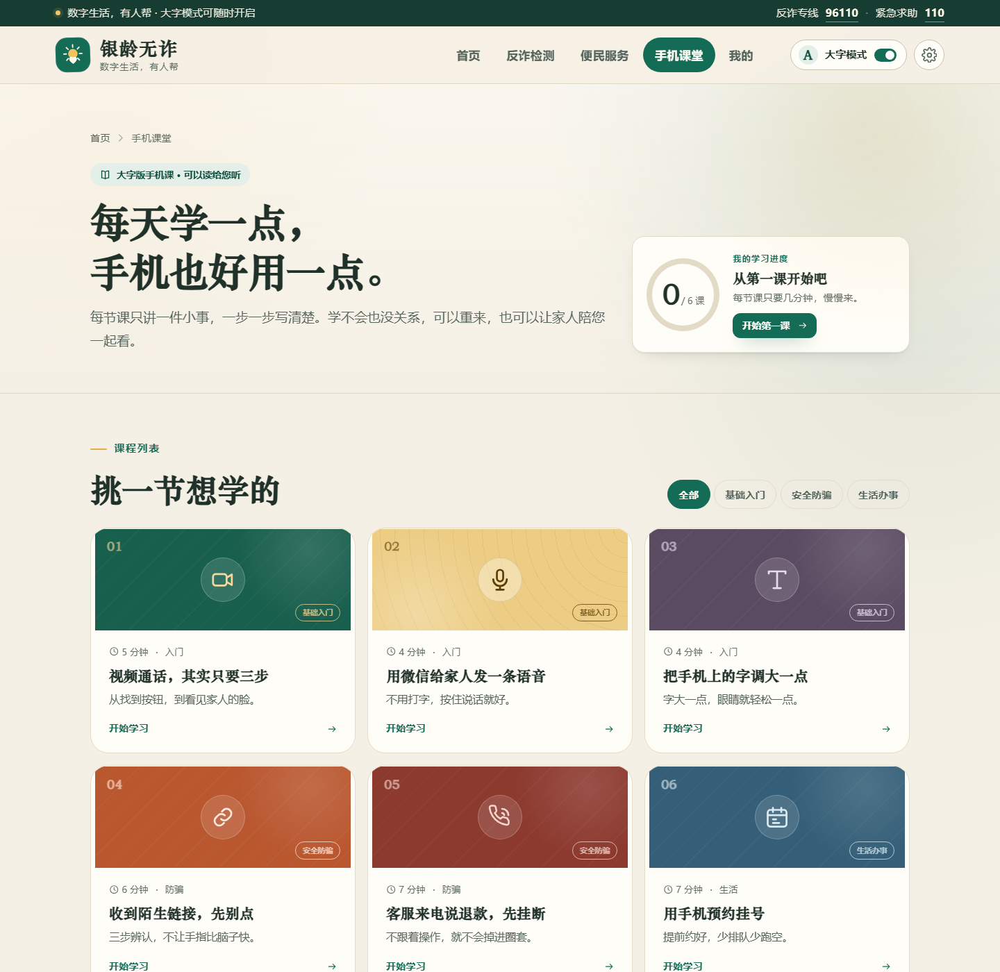
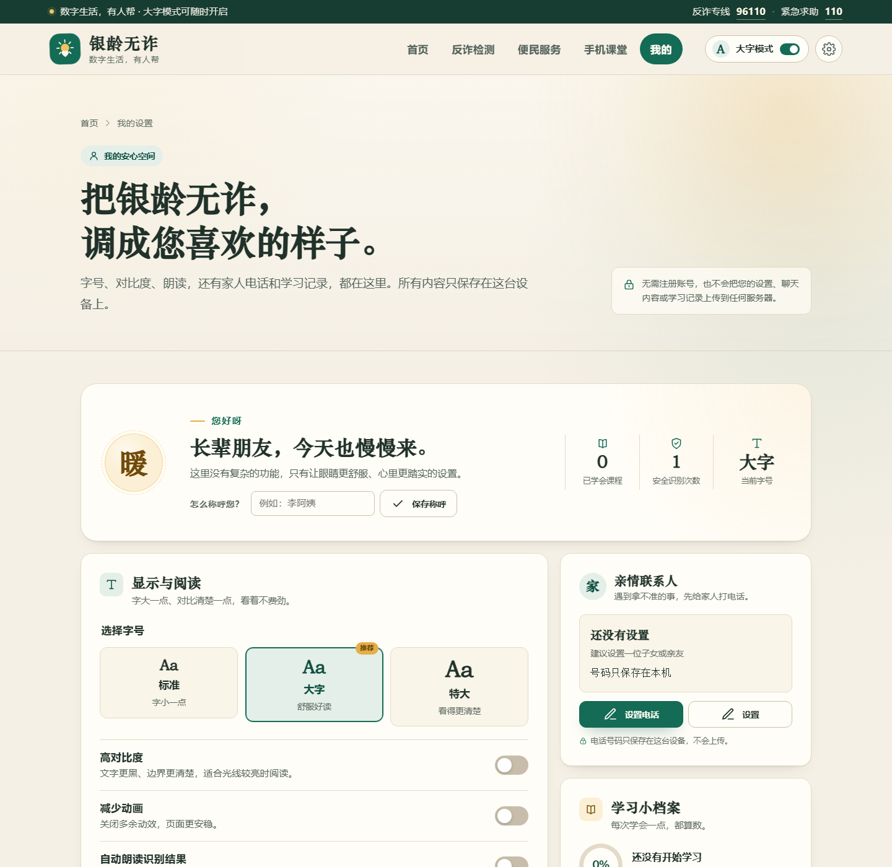
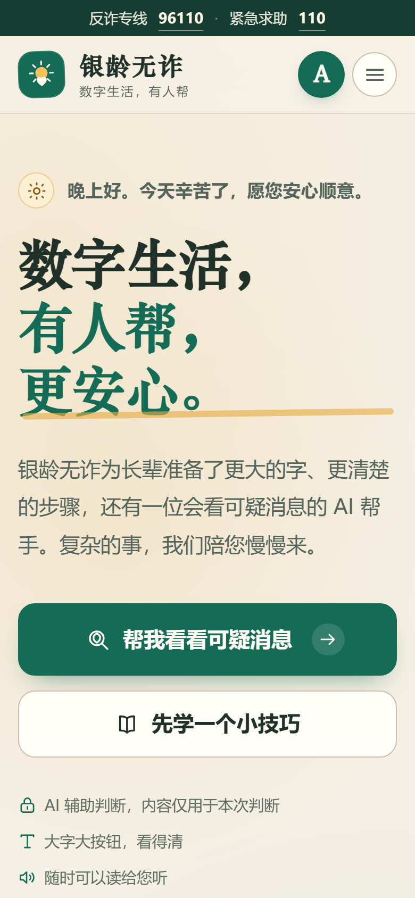

# 银龄无诈 · 作品文档

参赛团队：黄佳欣　江柏宁　张宇恒 
指导教师：夏恬恬 
提交日期：2026 年 11 月

## 1 项目详情与使用方式

### 1.1 是什么

银龄无诈是一个面向老年人的 Web 应用。核心功能只有一件事：**判断你手上这条短信、这段聊天记录、这张截图，像不像诈骗**，然后告诉你哪里可疑、接下来该怎么做。

除了反诈，还提供了老年人日常最容易卡住的几件事的分步指南（挂号、医保、社保认证、水电缴费、打车、视频通话等 19 项）和 6 节教手机操作的课。

线上地址：**https://czb.overpass.top**

### 1.2 为什么做这个

我们访谈过六位 65 岁以上的老人，问三个问题：最近一个月有没有收到过可疑短信、收到之后怎么处理、有没有人教过怎么判断。六个人都收到过，处理方式分别是"删掉""打电话问儿子""没管它""看不懂就没理"。没有人能说清楚自己为什么判断它是诈骗。

一位阿姨的原话是："我不认识字里那些道道，看着像是真的。"

现有的反诈宣传大多是"警惕诈骗"式的口号和案例，老人看完仍然不知道自己手里这一条是真的还是假的。所以我们把切口收得很小：**不做科普，只判断你手上这一条**。

### 1.3 怎么用

整个过程分三步，不需要注册、不需要下载 App：

1. 打开网址，点首页的「帮我看看可疑消息」；
2. 把短信复制进去，或者上传一张截图（也可以直接按着说话，语音会转成文字）；
3. 两三秒后开始出结论，先是一句话判断，然后展开三条可疑点、原文对照和处置建议。

识别结果可以「读给我听」（支持服务端语音合成），也可以「告诉家人」转发出去。页面底部的 96110 和 110 直接可拨。

### 1.4 使用条件

- 浏览器：Chrome、Edge、Safari 等现代浏览器；语音输入仅 Chrome / Edge 支持，其他浏览器会自动隐藏入口；
- 不需要注册、不需要登录，全站没有账号体系；
- 弱网可用：AI 接口不可用时前端会自动切换到本地规则引擎，仍然给出判断；
- 屏幕：桌面、平板、手机均可，字号支持三档调节。

## 2 项目亮点

**亮点一：把"防诈骗"变成一次具体判断。** 不是让人学反诈知识，而是直接回答"我手上这条是不是骗子"。用户不需要理解规则，只需要粘贴。

**亮点二：结论先出来，不用干等。** 采用流式输出，先逐字显示一句话判断，再补全依据和执行建议。实测首字延迟 2 到 3 秒，完整结果 6 到 10 秒。老人对转圈的容忍度很低，这个差别很实际。

**亮点三：每条判断都给依据。** 不会只丢一个"高风险"，而是列出 2 到 4 条具体可疑之处，例如"要求点击陌生链接填写银行卡号"。判据来自检索到的真实骗术案例，不是模型的自由发挥。

**亮点四：AI 挂了也能用。** 前端内置 19 类骗术的本地规则引擎。没有配置模型、网络断开、接口超时、返回格式异常，四种情况都会自动降级到本地判断，并明确告诉用户"已用本地规则判断"，不假装是 AI 结果。

**亮点五：适老化不是放大字号，是删掉门槛。** 全站没有注册入口，打开就能用。老人记不住密码，多一步注册就是一道墙。按钮最小高度 52px，正文默认大字，支持高对比度和减少动画。

**亮点六：真实在线运行。** 不是本地演示：有公网域名、HTTPS 证书、备案号、nginx 反向代理、常驻后端进程，评委可以直接打开体验。

## 3 AI 技术落地与使用情况

### 3.1 用在哪

| 能力 | 模型 | 落地形式 |
| --- | --- | --- |
| 反诈判断（文本） | DeepSeek-V3.2 | 流式生成结构化结果，SSE 推给前端 |
| 反诈判断（截图） | Qwen3-VL-8B | 图片理解 + OCR，返回同样的结构 |
| 知识检索 | bge-m3 + bge-reranker-v2-m3 | 27 条反诈知识库，两段式检索 |
| 语音朗读 | CosyVoice2-0.5B | 文字转 mp3，带缓存 |

平台统一走 SiliconFlow，调用方式为标准 HTTP 接口，没有绑定 SDK。

### 3.2 怎么落地的

**先检索，再判断。** 用户输入先做向量化，从 27 条反诈知识里检索最相关的 4 条，拼进 Prompt。这样模型看到的是"冒充公检法：要求转账到安全账户""索要验证码相当于交出钥匙"这类具体条目，而不是凭空推理。

**边生成边解析。** 结构化输出要求完整 JSON，流式输出要求逐字，两者天然冲突。我们的做法是固定字段顺序，把给用户看的那句话放在第一个字段，服务端逐块提取并推送。

**失败就降级。** 从"没有配置 Key"到"模型返回的不是 JSON"，四层兜底，任何一层失败都不会让页面白屏。

### 3.3 实测情况

线上环境，四类典型内容（每条约 50 到 60 字）：

| 输入 | 判定 | 风险分 | 首字 | 完整结果 | 检索命中 |
| --- | --- | --- | --- | --- | --- |
| 快递理赔 + 陌生链接 | 高风险 | 95 | 2.2 s | 6.4 s | 退款理赔 / 冒充客服 / 索要验证码 |
| 冒充公检法 + 安全账户 | 高风险 | 95 | 2.4 s | 8.4 s | 冒充公检法 / 要求保密 / 安全账户 |
| 正常社区健康讲座通知 | 低风险 | 5 | 2.6 s | 6.8 s | 保健品宣传 / 官方热线 |
| 冒充亲戚换号借钱 | 高风险 | 85 | 3.3 s | 15.3 s | 冒充亲友 / 要求转账 / 要求保密 |

第三行是我们最在意的一条：正常内容没有被误报成诈骗。如果模型什么都说高危，这个功能对老人就是纯噪音。

模型选型也做过横向对比，同一任务下 DeepSeek-V3.2 用时 10.1 秒、输出 148 token，Qwen3.5 系列为 22 到 30 秒、输出 1300 多个 token（`max_tokens` 参数未生效），因此选前者。

### 3.4 测试情况

| 层 | 数量 | 覆盖内容 |
| --- | --- | --- |
| 接口级 | 55 条断言 | 参数校验、边界值、错误码映射、限流触发、重复提交的幂等 |
| AI 链路 | 30 条断言 | SSE 帧格式、跨分片文本拼接、JSON 容错、上游 500 的降级 |
| 真实接口 | 探测脚本 | 模型可用性、流式行为、图片输入、向量维度、语音返回格式 |

AI 链路的测试完全离线：起一个假的上游服务，不需要 Key 也不联网，改代码后可以随时回归。

### 3.5 成本控制

- 单次分析约 1000 输入、150 输出 token，按量计费成本很低；
- 分析接口按 IP 限流每分钟 6 次，朗读接口 10 次，防止被当成免费代理；
- 知识库向量只在第一次调用时构建（一次 embedding 请求），之后走本地数据库；
- 朗读结果做进程内缓存，固定的建议语不重复计费。

## 4 关键技术

### 4.1 hint 优先的流式结构化输出

常规做法要么等完整 JSON（用户干等十秒），要么放弃结构化（前端无法渲染卡片）。我们在 Prompt 里把字段顺序固定为 `hint → level → score → reasons → advice`，模型按顺序生成 token，"给人看的那句话"最先出现。服务端用正则逐块提取 `hint` 的已生成部分，增量推给前端；生成结束后再整体解析 JSON。一个请求同时满足流式体验和结构化渲染。

### 4.2 两段式检索

反诈话术高度相似，很多都提到"转账"，纯向量检索容易把"高收益投资"排在"冒充公检法"前面。做法是先向量粗排取前 8 条，再用 reranker 精排到前 4 条。重排只多花 0.3 秒，但排序准确度明显提升。

### 4.3 四层降级

1. 服务端没有配置模型 Key：接口直接返回错误码，前端走本地引擎；
2. 上游超时或报错：服务端推送降级事件，前端同样回退；
3. 模型返回的不是合法 JSON：先尝试剥离代码块、截取首尾大括号，仍失败则降级；
4. JSON 字段非法：服务端按分数推导等级、把分数裁到 0 到 100，不让脏数据进前端。

### 4.4 双引擎

前端保留完整的本地规则引擎：19 类骗术、正则匹配、URL 风险分析（短链、IP 直连、可疑后缀、Punycode）、加权打分、原文高亮，765 行 JavaScript，零依赖。它是断网场景下唯一的判断依据，也是 AI 降级后的兜底。

两套引擎的衔接是主备关系，不是二选一：优先调 AI，失败后切本地，并明确提示用户当前用的是哪一种。

### 4.5 适老化交互

- 字号三档，改根字号联动全站，刷新后记住；
- 高对比度模式只改颜色变量，不改变内容结构；
- 减少动画模式同时影响 CSS 过渡和脚本滚动；
- 主要按钮 52px、重点操作 60px，间距留足；
- 识别结果、办事步骤、课程内容都可朗读，语速降到 0.88。

### 4.6 部署与流式穿透

nginx 终止 TLS，`/api/` 反向代理到 gunicorn，静态页面由 node 服务提供，两个进程都只监听回环地址。

流式输出有两个必须处理的点：后端返回 `X-Accel-Buffering: no`，nginx 侧配置 `proxy_buffering off`，否则前端会等到最后一次性收到全部内容；`proxy_read_timeout` 调到 300 秒，默认 60 秒会把长回答掐断。

## 5 项目截图

<figure>
<figcaption><strong>首页（桌面）</strong>：时段问候、快捷入口，右侧是能力示意卡片。默认就是大字模式。</figcaption>

</figure>

<figure>
<figcaption><strong>反诈识别结果</strong>：95 分高风险，三条 AI 发现的可疑点，右侧是分步处置建议。这张截图是在线上真实请求后拍的。</figcaption>

</figure>

<figure>
<figcaption><strong>便民服务</strong>：19 项办事指南，支持搜索和筛选，每项都有分步说明。</figcaption>

</figure>

<figure>
<figcaption><strong>手机课堂</strong>：6 节课，带学习进度和反诈小测验。</figcaption>

</figure>

<figure>
<figcaption><strong>我的（显示设置）</strong>：字号、对比度、减少动画、自动朗读，亲情联系人。所有数据只存在本机。</figcaption>

</figure>

<figure>
<figcaption><strong>手机端</strong>：单列布局，按钮加高，字号自适应。</figcaption>

</figure>

## 6 发表与获奖情况

本项目为本次大赛首次提交的原创作品。

在此之前，项目未在期刊、会议、博客或开源平台公开发表，未参加过其他比赛，也未获得过任何奖项。〔如团队另有情况，请在此处更正〕

## 7 原创性说明

本项目为独立开发，**不是在其他项目基础上优化或二次开发**，没有复用任何现有开源项目的前端模板、后端框架脚手架或规则库。

开发过程中参考的公开资料仅限于：

- 反诈常识与官方渠道信息：96110 反诈专线、110 报警、12381 涉诈预警、12333 人社热线、12393 医保热线，均为公开的公共服务信息；
- 使用的大模型与向量服务：SiliconFlow 平台提供的 DeepSeek-V3.2、Qwen3-VL-8B、bge-m3、bge-reranker-v2-m3、CosyVoice2-0.5B；
- 前端未引入任何第三方 UI 框架或组件库，样式与交互均为自行编写。
